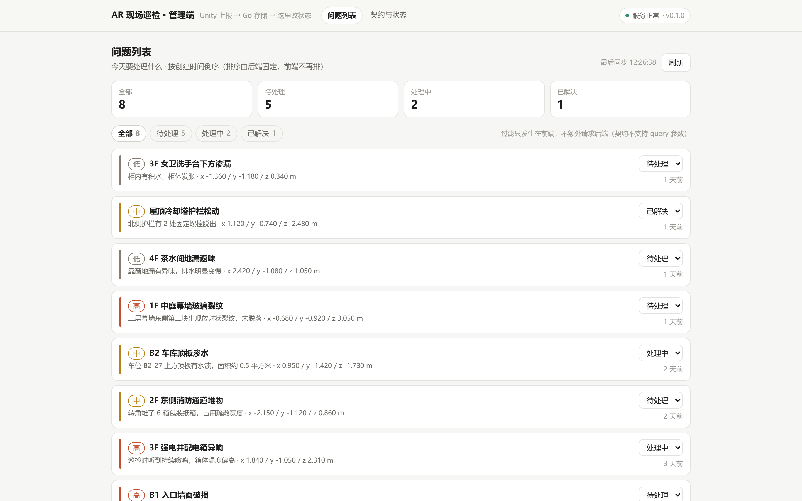
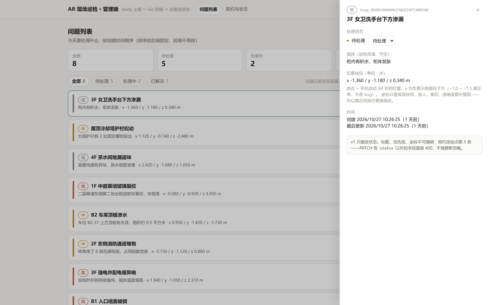
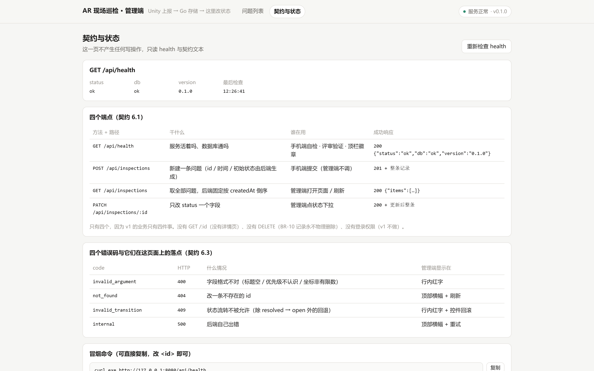
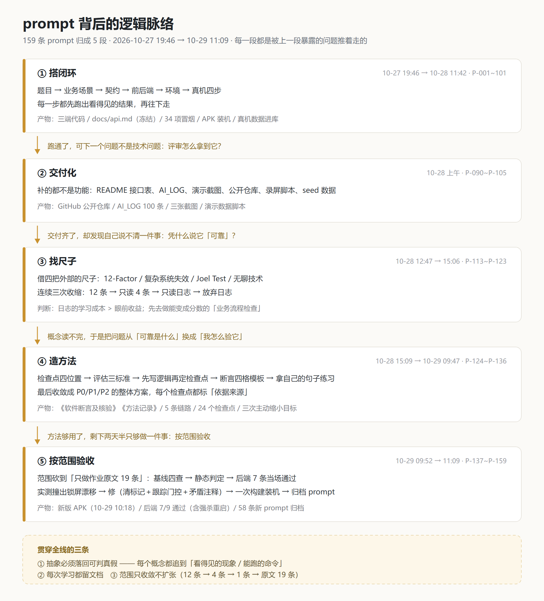

# AR 现场巡检问题标注

巡检员用手机在真实空间里放置 AR 标记并上报问题，管理员在网页上查看并更新处理状态。

三端最小闭环：**Unity(AR Foundation) 手机端 → Go 后端 → React 管理端**

---

## 当前状态

| 端 | 目录 | 状态 | 技术栈 | 现在能做什么 |
|---|---|---|---|---|
| 手机端 | `ar-client/` | ✅ 真机跑通（L1–L4） | Unity 2022.3.62f3 · AR Foundation/ARCore 5.1.6 · IL2CPP · ARM64 | 检测水平平面 → 点一下放橙色方块（锚定，转身回来不飘）→ 填标题/描述/优先级 → 提交到后端 → 方块变绿表示已入库；顶部常驻后端连接状态与「重连后端」按钮 |
| 后端 | `server/` | ✅ v1 | Go 1.26 · `modernc.org/sqlite` v1.61.0（纯 Go，无 cgo） | 四个端点、SQLite 持久化、统一错误体、优雅退出；34 项契约冒烟 + 13 项单测全绿 |
| 管理端 | `admin/` | ✅ v1 | React 18.3 · TypeScript 5.6 · Vite 5.4 | 列表 + 三态过滤 + 详情抽屉 + 状态修改（下拉）+ 后端健康徽标 + 契约页 + 请求日志核验面板 |

契约是三条线唯一的耦合点，已冻结在 `docs/api.md`（四个端点、记录结构、错误体、状态机、校验顺序、已知缺口、curl 冒烟命令）。开发版本一对应 tag `v1-dev`（只含前后端，不含 Unity）。

---

## 接口

后端就四个端点，手机端与网页端读写同一份 SQLite 数据。完整定义（字段约束、校验顺序、状态机、错误码）在 `docs/api.md`。

| 方法 + 路径 | 干什么 | 请求体 | 成功响应 |
|---|---|---|---|
| `GET /api/health` | 服务与数据库是否正常 | 无 | `200 {"status":"ok","db":"ok","version":"0.1.0"}` |
| `POST /api/inspections` | 新建一条问题 | `title`、`description`、`priority`、`position{x,y,z}` | `201` + 整条记录，`id` / 时间 / `status=open` 由后端生成 |
| `GET /api/inspections` | 取全部问题，按 `createdAt` 倒序 | 无 | `200 {"items":[…]}` |
| `PATCH /api/inspections/:id` | 只改 `status` 一个字段 | `{"status":"in_progress"}` | `200` + 更新后整条 |

一条记录：

```json
{
  "id": "insp_06GQW0PCPR6TVS8HRGHVRAKMJZ",
  "title": "B1 入口墙面破损",
  "description": "左侧墙体存在裂缝，长约 40cm",
  "priority": "high",
  "status": "open",
  "position": { "x": 0.42, "y": -1.30, "z": 1.26 },
  "createdAt": "2026-10-27T15:37:55Z",
  "updatedAt": "2026-10-27T15:37:55Z"
}
```

`position` 是 AR 会话坐标，单位米；`y` 常为负，因为原点是手机启动时的高度，地面在下方。`status` 取值 `open` / `in_progress` / `resolved`，`priority` 取值 `low` / `medium` / `high`。

任何错误都只有一种体：`{"error":{"code":"invalid_argument","message":"标题不能为空"}}`，`code` 四个固定值 `invalid_argument`(400) / `not_found`(404) / `invalid_transition`(409) / `internal`(500)。

---

## 界面

管理端三个页面（截图里的数据由 `server/scripts/seed.ps1` 造）：

| 问题列表 | 详情抽屉 |
|---|---|
|  |  |

「契约与状态」页把四个端点、四个错误码、以及每次请求的原始收发都摊在界面上，不用开 DevTools 也能核验数据是怎么流的：



手机端界面在真机上看（见下方「手机端怎么配后端地址」）。

---

## 快速开始

### 1. 后端

```powershell
cd server
go run ./cmd/api            # → http://127.0.0.1:8080，库在 server/data/inspections.db
```

验一下：`curl http://127.0.0.1:8080/api/health` → `{"status":"ok","db":"ok","version":"0.1.0"}`

### 2. 管理端

```powershell
cd admin
npm install
npm run dev                 # → http://localhost:5173（vite 已把 /api 代理到 127.0.0.1:8080）
```

没有后端也能单独跑：`npm run mock`（照契约实现的临时后端，支持 `MOCK_FAIL=409/404/500/bad_shape/nonjson`、`MOCK_LATENCY_MS` 故障注入）。

### 3. 手机端

前置：Unity Hub 里 **2022.3.62f3**，带 Android Build Support（SDK/NDK/JDK 在 Unity 的 External Tools 里指向本机安装目录）；手机开 USB 调试，机身是 arm64。

```powershell
# ① 先把手机的 8080 转发到电脑（必须做，否则手机连不上后端）
adb reverse tcp:8080 tcp:8080

# ② 装机（APK 在本地构建产物目录，不进仓库）
adb install -r ar-client/Builds/app.apk

# ③ 起后端（见上面第 1 步），保持它开着
```

Unity Hub 打开 `ar-client/` 目录 → `Assets/Scenes/Main.unity` → Build And Run 也可以。场景装配与打包有脚本：`Assets/Editor/ProjectSetup.cs`（一次性搭场景，不靠手点）、`Assets/Editor/BuildScript.cs`（命令行打包）。

**手机上怎么操作**：对着地面缓慢左右晃 → 出现平面网格 → 点一下放方块 → 弹出表单填标题（必填）/描述/优先级 → 提交 → 顶部提示"已上报 insp_xxx"，方块变绿。

---

## 手机端怎么配后端地址

手机不是电脑，`localhost` 指的是手机自己。两种接法，默认走第一种：

**① adb reverse（默认，推荐）** —— 不依赖 Wi-Fi，也不用改 IP。
`ar-client/Assets/Scripts/Api.cs` 里 `BaseUrl = "http://127.0.0.1:8080"`，配合 `adb reverse tcp:8080 tcp:8080`，手机的 127.0.0.1:8080 就是电脑的 8080。

⚠️ 这个转发会在 **USB 断开重连、adb 服务重启、手机锁屏断开调试、重新 install** 之后被清空，症状就是 App 里报"连不上后端"。重新执行一次 `adb reverse tcp:8080 tcp:8080` 即可，代码不用动。

App 顶部第一行常驻后端状态：`后端 已连接 v0.1.0 · 12:03:45` 或 `后端 未连接 · 点「重连后端」重试`。启动时查一次、每 20 秒兜底重查、每次提交后立刻刷新；转发断了不用重启 App，补一条 `adb reverse` 再点按钮即可。

**② 局域网直连** —— 想脱离 USB 时用。
把 `Api.cs` 的 `BaseUrl` 改成 `http://<电脑局域网IP>:8080`，手机与电脑同一网段，电脑防火墙放行 8080。

失败提示分两种，来自契约错误体：后端讲理由的（如 400 `invalid_argument`）直接显示它的 message；压根没连上的显示"连不上后端服务"。表单在失败时**不清空已填内容**，可以直接重试。点「取消」= 这次上报作废，方块连同锚点一起消失，不会留下孤儿标记；只有提交成功才会留下绿色标记。

---

## 已完成

**作业 3.1 Unity AR 移动端**：真机运行 ✅ · 检测水平平面 ✅ · 点平面放标记（命中位置，挂锚点不飘）✅ · 填标题/描述/优先级并提交 ✅ · 提交成功/失败有明确提示 ✅ · 打开表单时不误放标记 ✅

**作业 3.2 React 管理端**：从后端取列表 ✅ · 展示标题/描述/优先级/状态/时间 ✅ · 三态修改（open / in_progress / resolved）✅ · 修改结果立即反映 ✅ · 后端不可用时页面不白屏、有错误提示与重试 ✅

**作业 3.3 Go 后端**：健康检查 ✅ · 接收并保存上报 ✅ · 返回列表 ✅ · 按 id 改状态 ✅ · 唯一 id + 默认 open ✅ · 参数错误有明确说明（400 + 错误码）✅ · 重启后数据仍在（SQLite 落盘）✅

**工程侧**：契约独立成文档并冻结 · 34 项契约冒烟脚本 · 13 项 model 单测 · 统一错误体 · 优雅退出 · 管理端请求日志核验面板 + `DATAFLOW.md` · 三端字段名逐字对齐（C# DTO / Go struct tag / TS type）

---

## 未完成 / 已知问题

**功能缺口**

- **状态变更历史留痕**（业务规则 BR-08 要求）：目前只存当前状态，没有变更流水表。
- **处理人与验收证据**：无字段、无界面。
- **现场截图上传**：契约已预留端点（`docs/api.md` 第 9 节），v1 不实现。
- **鉴权、分页、作废状态、离线队列**：全部未做。

**已知问题**

- **墙面检测效果差**：ARCore 的平面检测只凑几何、不认语义。地面（含桌面）能勉强覆盖，垂直面常常一块块"插进实体墙面里"。跨会话/跨设备找回同一位置也没有做——按设计这是加分项，需要 4×4 变换矩阵对齐两个会话的坐标系，v1 明确不做。
- **手机端界面是 IMGUI 画的**，很简陋。选择它是因为 Unity 内置字体在 Android 上能正确显示中文，不用额外处理字体回退；优先保证"能填、能提交、有回馈"。
- **`adb reverse` 会掉**（见上文），属于环境问题不是程序缺陷。
- **构建产物不进仓库**：`ar-client/Builds/app.apk` 在 `.gitignore` 里，需要自己按上面第 3 步构建。

**交付缺口**

- 两段 3–5 分钟演示视频（手机端 + 电脑端）还没录。
- 仓库还没有配置远程（GitHub/Gitee 链接待提供）。

---

## 测试与验证

| 项 | 命令 | 现状 |
|---|---|---|
| 服务端契约冒烟（34 项） | `cd server; powershell -NoProfile -ExecutionPolicy Bypass -File scripts/smoke.ps1` | 全绿 |
| 服务端单测（13 项） | `cd server; go test ./...` | 全绿 |
| 管理端类型检查 + 构建 | `cd admin; npm run build` | 通过（gzip 约 62 kB） |
| 管理端真点 | 浏览器 + 请求日志面板 | 改状态 → PATCH → 界面与统计同步；`MOCK_FAIL` 各分支都亲手触发过 |
| 手机端 | 真机（小米 24129PN74C / arm64） | L1 平面 → L2 放置不飘 → L3 上报入库 → L4 网页可见并可改，逐环点过 |

改了后端或契约之后，冒烟脚本必跑。

---

## 工程结构

```
ar-device/
├─ docs/api.md          冻结的接口契约（唯一耦合点）
├─ server/              Go：cmd/api 装配 + internal/{model,store,api} 四层单向依赖
├─ admin/               React+TS：src/{api,components,hooks,pages,types}，DATAFLOW.md 记录数据流
└─ ar-client/           Unity：Assets/Scripts/{Api,ARPlacement,SubmitForm,ARHUD}.cs + Assets/Editor/{ProjectSetup,BuildScript}.cs
```

三条线并行开发、互不阻塞，只按 `docs/api.md` 写代码。提交粒度按主题拆，提交信息标明是哪条线。


## 设计与过程文档

设计与过程材料收在 `docs/`，入口是 **[docs/README.md](docs/README.md)**：

- `docs/design/` —— 业务规则、架构设计、可靠性与可维护性的验收条目、断言与核验（5 条链路 / 24 个检查点）
- `docs/process/` —— 方法记录、迭代计划、技术学习清单、开源借鉴清单、录屏脚本、提示词脉络

### 提示词脉络

159 条 Prompt 背后的 5 段转向与三次主动缩小目标。文字版见 [docs/process/06-提示词脉络.md](docs/process/06-提示词脉络.md)。


## AI 使用记录

见仓库根目录 `AI_LOG.md`：全部 prompt 原文，按时间正序，每条含目标、结果（采用 / 修改后采用 / 未采用）与验证方式，开头有索引表。