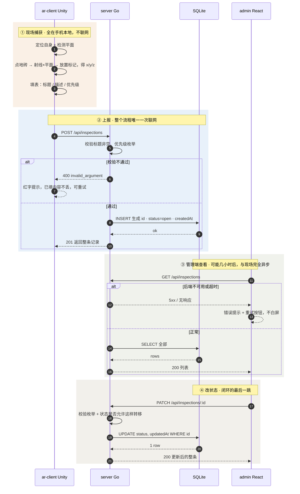

# 开发版本一：架构设计

> 本文只写"谁负责什么、谁跟谁说话"。代码实现细节另见各端 README。

## 一、目录

单仓三目录（**已确认 A 方案**）：一个 repo，三个顶层目录，Unity 工程就是一个子目录。

```
ar-inspection/                ← 独立 git 仓库（与个人 workspace 隔离，交付时 push 到 GitHub）
├─ README.md                  启动命令 / 完成度 / 已知问题（评审第一入口）
├─ AI_LOG.md                  AI 使用记录，题目要求放在项目根目录
├─ .gitignore                 只放 Node + Go + OS/IDE，不含任何 Unity 规则
├─ .gitattributes             禁止 git 对 Unity YAML 做行尾转换
├─ docs/
│  ├─ api.md                  接口表 + 错误码 + curl 示例
│  └─ img/                    演示截图
├─ ar-client/                 ← Unity 工程根，Hub 直接打开这一层
│  ├─ .gitignore              ★ 官方 Unity 模板原样放这里
│  ├─ Assets/                 场景、C# 脚本、预制体、AndroidManifest
│  ├─ Packages/               manifest.json + packages-lock.json
│  └─ ProjectSettings/        含 ProjectVersion.txt，锁定 Unity 版本
├─ server/                    ← Go 模块根
│  ├─ cmd/api/main.go
│  ├─ internal/{api,store,model}
│  └─ data/                   SQLite 运行时文件（不提交）
└─ admin/                     ← Vite + React + TS
   └─ src/{api,types,hooks,components,pages}
```

### 三条硬约束

1. **Unity 的 `.gitignore` 必须放在 `ar-client/` 里，不能放仓库根目录。**
   官方模板用的是 `/[Ll]ibrary/` 这类**前导斜杠锚定**规则，只相对它自己所在目录求值。放根目录 → 匹配 `<repo>/Library/`，而真正该忽略的 `<repo>/ar-client/Library/` 完全裸露 → 一次 `git add -A` 就是 2 GB。
2. **`.meta` 必须提交，`Library/` 绝对不能提交。**
   Unity 每个资产配一个 `.meta`（存 GUID），场景和预制体全靠 GUID 引用资源；漏 `.meta` = 引用全断。而 `Library/` 是导入缓存，Unity 能自动重建。
3. **Unity 工程目录只有一层。**
   `ar-client/` 下面直接是 `Assets/`、`Packages/`、`ProjectSettings/`，不再套一层 `UnityProject/`。

> 状态：目录方案已确认；`server/` 内部包划分（`cmd/api` + `internal/{api,store,model}`）为**提案，待定**。

## 二、整体架构

### 2.1 三端各自是什么

| 端 | 一句话职责 | 拥有什么状态 |
|---|---|---|
| **ar-client** | 采集器 + 表单 | AR 会话态（相机位姿、平面、标记坐标）+ 正在填的表单 |
| **server** | 校验 + 存储 + **唯一真源** | 全部记录的权威副本；负责生成 id 与时间戳 |
| **admin** | 渲染器 + 意图发送器 | 只有 UI 态（列表、筛选、正在编辑的行），关掉浏览器即消失 |

**中间那一端是唯一真源，两边都不缓存任何东西。**

### 2.2 数据流转时序



### 2.3 四条要点

1. **只有 ② 这一段真的联网。** ① 的定位、检测、放置、填写全在手机本地，断网也能做，只是交不出去。
2. **server 是唯一真源。** admin 每次打开都重新 `GET`，三端谁也不缓存。所以"服务重启后数据仍然存在"这条，只要 SQLite 写对了就是天然满足的。
3. **③ 和 ④ 与现场完全异步。** 人和人之间没有实时连接，中间的"连接"就是库里那条记录。这也是为什么位置必须配文字（和截图）才能完成交接。
4. **SQLite 不是独立服务。** 它嵌在 Go 进程里，server 挂掉 = 数据没了 + 网页白屏同时发生，所以 admin 必须有错误态。

### 2.4 三条边界规则

1. **谁生成身份** → server。id、两个时间戳、初始状态全在服务端生成，另外两端只接收。
2. **谁判断合法** → server。ar-client 只发"我填了这些"，admin 只发"我想把它改成 in_progress"这个**意图**；能不能存、能不能改由 server 说了算。
3. **谁拥有真相** → server。另外两端的界面永远是某次响应的快照，随时可以整个丢掉重来。

守住这三条，三个骨架自然分开：
**ar-client = 采集器 + 表单；server = 校验 + 存储 + 真相；admin = 渲染器 + 意图发送器。**

## 三、ar-client

**拥有的状态**：AR 会话的瞬时状态（相机位姿、已检测平面、已放标记的 transform）、用户正在填的表单。全是"App 一关就消失"的东西。

### 本地逻辑（占 90% 运行时间，全不联网）

| 编号 | 做什么 | 关键约束 |
|---|---|---|
| L1 | 启动 AR 会话，持续读跟踪状态 | 跟踪 Limited / None 时**禁止放置**并提示，否则坐标是错的 |
| L2 | 订阅平面事件，生成可视化网格 | 无平面时给引导话术，不能一片黑 |
| L3 | 点屏幕 → 射线与平面求交 → 生成标记 → 记下坐标 | **点 UI 时不能触发放置**（题目 3.1 第 6 条） |
| L4 | 表单：标题必填、优先级三选一 | 提交前本地先拦一次，省一次失败往返 |
| L5 | 提交三态：进行中 / 成功 / 失败 | 失败必须**保留已填内容** |
| L6 | 重试 | v1 手动重试；不做离线队列 |

### 发起的通信（只有出站）

| 时机 | 请求 | 带什么 | 失败怎么办 |
|---|---|---|---|
| 点提交 | `POST /api/inspections` | title、description、priority、position{x,y,z} | 红字提示 + 内容不丢 + 可重试 |
| 打开 App（可选） | `GET /api/health` | 无 | 顶栏显示"未连接后端"，**但放置照样能用** |

### 绝对不做

不生成 id、不生成时间戳、不判断状态能不能改、不缓存历史记录。

## 四、server

**拥有的状态**：全部记录的唯一权威副本。这一端挂了，另外两端就都瞎了。

### 本地逻辑

| 编号 | 做什么 | 关键约束 |
|---|---|---|
| S1 | 格式校验 | 标题非空非空白、优先级 ∈ {low, medium, high}、坐标是有限数 |
| S2 | 生成 id / status=open / createdAt / updatedAt | 客户端传来的这些字段一律忽略 |
| S3 | 状态转移校验 | 枚举合法性 + 允许的流转（`resolved` 能否重开取决于业务决策） |
| S4 | 持久化 | 启动时建表；进程重启后数据仍在 |
| S5 | 统一错误出口 | 只有一处写 HTTP 状态码与错误体 |
| S6 | 健康检查 | ping 一次 DB |

### 发起的通信

**对外 0 个**：不调第三方、不发通知、不做推送。
对内对 SQLite 有 4 条 SQL：建表、SELECT 列表、INSERT、UPDATE。

### 绝对不做

不做鉴权（v1）、不做定时任务、不做分页排序之外的查询能力。

> 状态：内部包划分为**提案，待定**（`cmd/api` 装配 + `internal/api` HTTP + `internal/store` SQL + `internal/model` 结构体与校验；不含 service 层）。

## 五、admin

**拥有的状态**：几乎为零。只有 UI 态——当前列表、筛选条件、正在编辑的那一行。关掉浏览器就没了，不需要恢复。

### 本地逻辑

| 编号 | 做什么 | 关键约束 |
|---|---|---|
| A1 | 拉列表 | 三态齐全：加载中 / 空 / 错误（错误必须带重试） |
| A2 | 渲染 | 至少显示标题、优先级、状态；默认按创建时间倒序 |
| A3 | 改状态 | **等后端返回再更新界面**，不做乐观更新 |
| A4 | 错误归一 | 网络错 / 4xx / 5xx 全部翻成人话 |
| A5 | 重试 | 错误态一键重试 |

### 发起的通信

| 时机 | 请求 |
|---|---|
| 打开页面 / 点重试 | `GET /api/inspections` |
| 点状态下拉 | `PATCH /api/inspections/:id`，body 只有 `{"status": "..."}` |

### 绝对不做

不本地造数据、不本地改完不回写、不缓存跨会话。

## 六、共享契约

> 这一节是**三端唯一的事实来源**。字段名、路径、错误码的任何改动，先改这里，再改代码。
> 状态：**已冻结（2026-10-27）**。任何改动按 6.4 的流程走。

### 6.1 四个端点是什么

"端点"就是**后端对外开放的一个地址 + 一个动作**。方法只有三种含义：

- `GET` = 读，不改数据
- `POST` = 新建一条
- `PATCH` = 改已有的某几个字段

把整条链路需要后端做的事列完，只有四件，所以是四个端点：

| # | 方法 + 路径 | 谁在用 | 干什么 | 请求体 | 成功响应 |
|---|---|---|---|---|---|
| 1 | `GET /api/health` | 手机端启动自检、评审验证 | 报平安：服务活着吗、数据库通吗 | 无 | 200 `{"status":"ok","db":"ok","version":"0.1.0"}` |
| 2 | `POST /api/inspections` | 手机端提交 | 新建一条问题；id / 时间 / 初始状态由后端生成 | `title`、`description?`、`priority`、`position` | 201 + 整条记录 |
| 3 | `GET /api/inspections` | 管理端打开页面 | 取全部问题 | 无 | 200 `{"items":[ … ]}` |
| 4 | `PATCH /api/inspections/:id` | 管理端改状态 | 只改 `status` 一个字段 | `{"status":"in_progress"}` | 200 + 更新后整条 |

**列表为什么包一层 `{"items":[…]}`**：Unity 的 `JsonUtility` 无法反序列化顶层数组。包一层后，三端都不需要写自定义解析器。

### 6.2 一条记录长什么样

```json
{
  "id": "insp_000123",
  "title": "B1 入口墙面破损",
  "description": "左侧墙体存在裂缝",
  "priority": "high",
  "status": "open",
  "position": { "x": 0.42, "y": -1.30, "z": 1.26 },
  "createdAt": "2026-10-27T13:21:00Z",
  "updatedAt": "2026-10-27T13:21:00Z"
}
```

| 字段 | 类型 | 谁生成 | 约束 |
|---|---|---|---|
| `id` | string | server | 不透明字符串，前端只透传，不解析 |
| `title` | string | 手机端 | trim 后 1–100 字，**必填** |
| `description` | string | 手机端 | 0–500 字，可空，缺省 `""` |
| `priority` | string（枚举） | 手机端 | `low` / `medium` / `high` |
| `status` | string（枚举） | **server** | `open` / `in_progress` / `resolved`；新建时固定 `open` |
| `position` | object | 手机端 | `x`/`y`/`z` 三个有限浮点数，单位**米**，保留 3 位小数 |
| `createdAt` | string | **server** | RFC3339，UTC |
| `updatedAt` | string | **server** | 同上，每次改状态刷新 |

**一个容易误判的点**：`position.y` 通常是**负数**（原点在手机启动时的高度，地面在下方约 -1.0 ~ -1.5 米）。这不是 bug。

### 6.3 错误体是什么

不管出什么错，后端返回的 JSON 永远只有这一种形状：

```json
{ "error": { "code": "invalid_argument", "message": "标题不能为空" } }
```

- `code` —— 给机器看的，四个固定值，前端据此决定处理方式
- `message` —— 给人看的，中文，可直接显示

| `code` | HTTP 状态 | 什么情况 | 谁显示给谁 |
|---|---|---|---|
| `invalid_argument` | 400 | 字段格式不对：标题空、优先级不认识、坐标不是有限数 | 手机端红字 / 管理端提示 |
| `not_found` | 404 | 改一条不存在的 id | 管理端"记录已不存在，请刷新" |
| `invalid_transition` | 409 | 状态流转不被允许（是否允许 `resolved → open` 取决于业务决策） | 管理端提示 |
| `internal` | 500 | 后端自己出错 | 统一"服务异常，请重试" |

**为什么必须统一形状**：Unity 端只有一份解析代码、admin 端只有一个错误归一函数。形状一变，三端全要改。

### 6.4 冻结后的三条纪律

1. 改契约 = 改这一节 + 同时改三端（Go struct tag / TS type / C# DTO）→ 一次 commit 完成。
2. 每次改完立刻跑 6.5 的冒烟命令，确认契约没漂。
3. 契约冻结之后，三端可以完全分开开发，谁落后都不影响另外两端。

### 6.5 冒烟命令（契约健康检查）

```powershell
# 1 健康
curl.exe http://127.0.0.1:8080/api/health

# 2 新建（注意 position.y 为负）
curl.exe -X POST http://127.0.0.1:8080/api/inspections -H "Content-Type: application/json" `
  -d '{\"title\":\"B1 入口墙面破损\",\"description\":\"左侧墙体存在裂缝\",\"priority\":\"high\",\"position\":{\"x\":0.42,\"y\":-1.30,\"z\":1.26}}'

# 3 列表
curl.exe http://127.0.0.1:8080/api/inspections

# 4 改状态（把 insp_000123 换成上一步返回的 id）
curl.exe -X PATCH http://127.0.0.1:8080/api/inspections/insp_000123 -H "Content-Type: application/json" `
  -d '{\"status\":\"in_progress\"}'

# 5 校验失败的样子（应看到 400 + invalid_argument）
curl.exe -X POST http://127.0.0.1:8080/api/inspections -H "Content-Type: application/json" -d '{\"title\":\"\"}'
```
### 6.6 已冻结的决定

| # | 细节 | 决定 | 理由 |
|---|---|---|---|
| 1 | 重复改成同一状态 | **200，幂等**，不报错 | 管理员手快点两次，不该看到红字 |
| 2 | `resolved` 能否重开 | **允许 `resolved → open`**；其它回退一律 409 | 裂缝会复发（对应 BR-07） |
| 3 | 多字段同时出错 | **只返回第一个错误** | 三端实现最简，用户改完再提交 |
| 4 | `error.code` | **保留四个 code** | 日志可 grep、提示位置可分流 |
| 5 | PATCH 只接受 `status` | 传其它字段 → **400 `invalid_argument`**，不静默忽略 | 明确优于宽容，避免"改了却没生效" |
| 6 | 现场截图 | **v1 不做**，契约预留（见 6.7） | 保证主线闭环成功率优先 |

### 6.7 预留扩展：现场截图（v1 不实现）

业务上截图是"位置不可复用"唯一便宜的补丁（对应 BR-05），但它会给手机端多加一条上传链路和一个失败面，所以 v1 不做。将来加的时候不破坏已冻结的四个端点：

- 新增第 5 个端点：`POST /api/inspections/:id/screenshot`，`multipart/form-data`，字段名 `file`，限 PNG/JPEG、≤2 MB
- 成功：201 `{"screenshotUrl":"/uploads/xxx.jpg"}`
- 记录结构新增一个**可空**字段 `screenshotUrl`（新记录为 `null`，老数据不受影响）
- **截图上传失败不阻塞主流程**：记录已经创建成功，截图只是补充